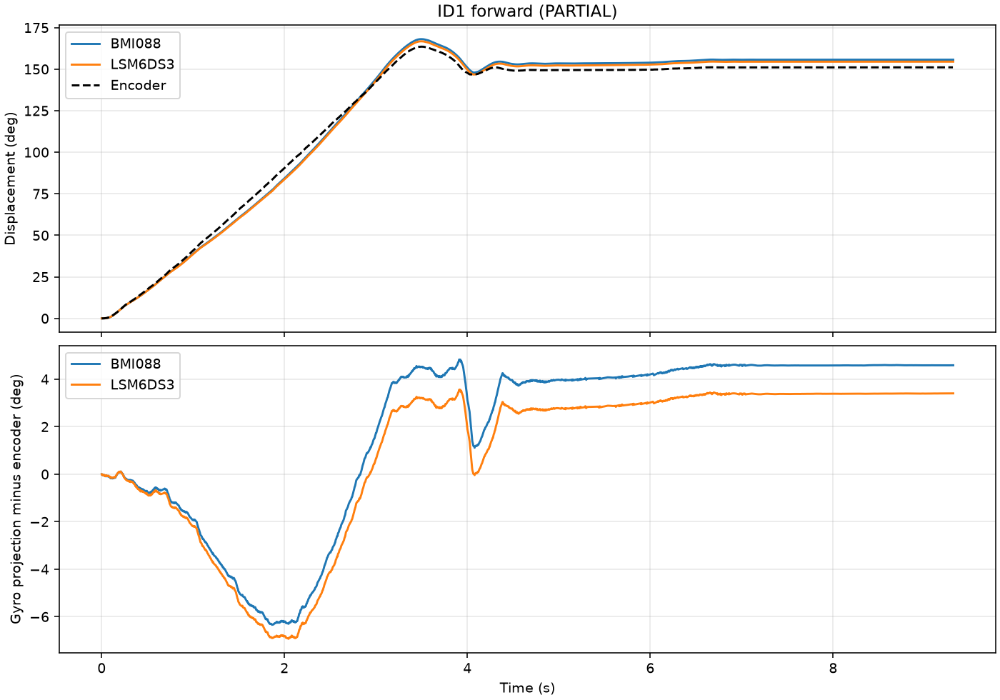

# 验证记录

本文保存对应归档的原始报告。日期、版本、通过范围和结束状态仅对当时现场有效，不表示当前板上状态。当前阅读方法见本目录说明文件。

---

<!-- 原报告：README.md；原文 SHA256：12c1723fdda381ab61d226bf3e2eef26a1f81b80dec93ce1103fcad142845484 -->

# 转台直接双环与超速抗抖动 — 2026-10-09

## 最终实现和实机状态

最终revision6保留在板上（run4.elf）：直接位置P外环→速度PI内环→电压输出。位置增益4，速度限幅ID1=54°/s、ID2/3=27°/s，三轴电压上限25000。虚拟角度、轨迹速度、轨迹加速度限制、轨迹跟随误差保护、额外速度阻尼前馈全部移除。保留输出电压斜率：ID1/2双向40000raw/s，ID3上升8000、下降40000raw/s。

ID1速度PI=100/100，控制用编码器差分低通20ms；ID2/3速度PI=200/100、低通100ms。对外速度遥测和到位判定仍使用100ms平滑速度。初次直接双环试验出现真实起转超调后，只调整了ID1内环参数，没有恢复虚拟轨迹。

已完成三轴回位，ID1正转实测速度约54°/s，平滑估计峰值56.58°/s。但转过约151.08°后停在raw3787，达到25000仍未继续；高输出3秒窗口净移动13raw=0.571289°，末两秒几乎静止，触发Fault7/轴1。采集末ID1温度40°C。**完整ID1整圈、返回、ID2整圈与ID3端到端尚未完成。**

最终GDB读取inhibit=7、Fault::Stalled和三轴命令0后detach；随后独占CDC1再次确认仍锁存全零，释放串口。J-Link/GDB均已关闭，无保留断点。ID3零输出后因重力回落约4045。**重启会清除RAM锁存并重新自动运动。**

## 抗抖动与保留保护

已取消较低阈值的单帧越限停机。运行阈值连续50ms才触发，恢复正常就清零计时：

| 轴 | 估计速度持续阈值 | 原始rpm持续阈值 | 估计速度即时阈值 | 原始rpm即时阈值 |
|---|---:|---:|---:|---:|
| ID1 | >72°/s | ≥14rpm | >108°/s | ≥24rpm |
| ID2/3 | >36°/s | ≥7rpm | >54°/s | ≥12rpm |

ID3到默认5140后启用严格4200→跨零→2160越界归零，扫描目标4264/2096不变。首次启动豁免、连续2秒静止、反馈20ms、命令20ms、控制周期10ms、65°C、3秒高输出净位移不足0.6°（目标误差>1°）、单阶段240s和STOP保护保留。保护不是机械制动。

## 本轮四次固件实测

| 试验 | 版本与变化 | 结果 |
|---|---|---|
| run1 | revision4，三轴27°/s、9°/s² | ID1约27°/s运动中原始7rpm单次判据触发，Fault11 |
| run2 | revision5，低阈值连续50ms确认 | 不再因该短尖峰停止；约149.4°处25000仍停滞，3秒2raw，Fault7 |
| run3 | revision6，直接双环、ID1=54°/s，旧200/100与100ms内环 | ID1起转真实超调，双IMU故障前测得约86°/s；原始≥14rpm持续50ms触发，锁存值-19rpm |
| run4 | revision6，ID1内环100/100与20ms反馈 | 三轴回位和ID1约54°/s部分正转通过；最终真实高输出停滞，Fault7，非单帧反馈抖动 |

run1/2使用旧轨迹的历史结果，不能作为最终直接双环的验证。run3/4共享序列格式版本6，通过独立ELF及SHA区分调参候选。没有在同一探针上并行运行服务器。

## 最终run4双IMU比较

BMI088 35560样本、LSM6DS3 35559样本；序号不连续和解码错误均0。

| 运动段 | 编码器位移 | BMI088 | LSM6DS3 |
|---|---:|---:|---:|
| ID3抬升 | 47.988° | 47.975° | 47.809° |
| ID1部分正转 | 151.084° | 155.673° | 154.489° |

ID3从开始恢复到切入ID1回位约11.464秒。ID1部分比较排除保护前最后约0.1秒以及保护后重力回落。分析扣静止偏置，ID1投影轴由同段数据估计，ID3取三轴积分向量模；这是相对一致性观测，不是独立精度标定。完整正反/其他轴扫转仍缺数据。

## 验证范围与文件

按用户要求，最终直接双环只运行针对性控制/保护检查（--guards-only）和增量固件编译，未重复全构建矩阵或重力模型调参。通过位置外环饱和/小误差、跨零限位、首次豁免、短尖峰不累计、持续超速与大幅超速、反馈/时序/温度/堵转/STOP和发送命令过期检查。早期revision4/5的全矩阵结果不冒充revision6验证。

SDK公共API、CubeMX生成代码、线程调度和内存分区未改；最终D1=279744B，ITCM=63104B，Flash=302048B。J-Link10114514、STM32H723VG、SWD4MHz、3.30V；所有下载.text校验匹配。最终产物build/IMUTurntable27/board/run4.elf与当前构建一致。

本目录包含四轮摘要、分析、图、GDB/采集日志、最终针对性检查和构建日志、释放后复核；大型rx.bin与ELF保存在build/IMUTurntable27/board，SHA256见manifest.json。
