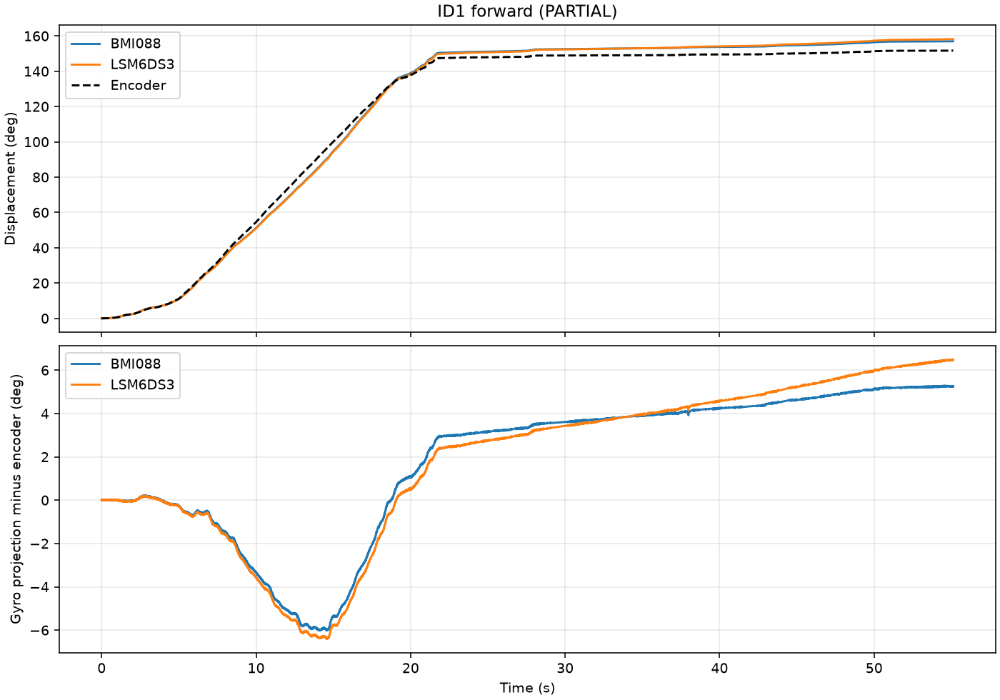

# 验证记录

本文保存对应归档的原始报告。日期、版本、通过范围和结束状态仅对当时现场有效，不表示当前板上状态。当前阅读方法见本目录说明文件。

---

<!-- 原报告：README.md；原文 SHA256：675090eff88a45c604be6d217fbdeb548df9044bd87d2224350a5236fe1ab44a -->

# 转台 25000 / 9°/s — 2026-10-09

## 当前状态

用户确认无外物阻碍、负载过大，明确要求上限25000、三轴速度再提高3倍。最终revision 3已烧录：三轴电压指令上限均±25000，恢复/回位/扫转目标均9°/s；加速度保留3°/s²，估计速度保护由8调整为15°/s，避免9°/s目标本身越限；原始转速5rpm、65°C、限位、反馈/命令时效及3秒高输出净位移保护保留。默认350/4850/5140、ID1/2各361°往返、ID3内缩4264/2096及到默认位结束首次豁免不变。

**实机仍未完成完整扫转。** 最终run2三轴回位成功；ID1转过约151.70°，在raw约3802处达到25000仍没有足够位移，最后高输出3秒净移动2raw（0.087890625°），Fault7/轴1归零。采集末ID1温度49°C；不能把CAN电压raw直接换算成实际电流或扭矩。用户已确认无外物阻碍，本次证据仅证明当前输出无法完成此段负载运动。

板端保留run2固件并锁存保护。GDB读取inhibit=7、Fault::Stalled及三个command=0后detach，CDC1再次确认全零；ID3约4044。探针和串口已释放，无保留断点。停止后的原始角度仍会随外力/重力变化，不能将零输出视为制动。RAM锁存会在复位时清除，**重新上电仍会自动开始运动**。

## 两轮过程与修复

run1已配置25000/9°/s，但ID1约147.8°时跟随误差8.006°触发Fault7，触发前1秒输出仅约3000，并未验证到25000。原逻辑在参考领先实际超过2°时只把轨迹期望速度设零；9°/s、3°/s²下虚拟轨迹仍需13.5°减速距离，因而继续前冲。此前3°/s的停止距离仅1.5°。

最终改为参考角度硬限在实际位置±2°，触边将虚拟轨迹速度清零；物理电压斜率及速度上限仍生效。新增9°/s轨迹突然遇到停滞负载的测试：参考始终不超2°，随后到真实输出上限仍停滞才由3秒堵转保护结束。没有继续放宽8°跟随误差或15°/s超速阈值。

run2使用修复固件，ID1确实达到-25000，反馈电流绝对值曾约15600raw；未把该反馈换算为安培。持续高输出期间位移不足，最终保护正确触发。ID2整圈、ID3两端往返未执行。

## 速度和双IMU比较

| 项目 | run1 | 最终run2 |
|---|---:|---:|
| ID3首次恢复开始至到位切阶段 | 17.216s | 18.451s |
| ID1正转位移（部分） | 147.83° | 151.70° |
| BMI088样本 | 68099 | 109786 |
| LSM6DS3样本 | 68098 | 109790 |
| 两流序号不连续/解码错误 | 0/0 | 0/0 |

9°/s为目标值，并非所有轴、所有时刻的实测速度。run2 ID1正向估计速度峰值约10.72°/s、ID3约7.88°/s。回位包含负载建立及稳定等待，因此目标提速3倍不等于耗时恰好缩短3倍。

最终run2扣静止偏置后的比较：

| 运动段 | 编码器 | BMI088 | LSM6DS3 |
|---|---:|---:|---:|
| ID3抬升 | 47.944° | 47.773° | 47.742° |
| ID1部分正转 | 151.699° | 156.976° | 158.201° |

加速后不能再把启动后的前3秒视为静止；revision3的ID3分析改用等待阶段约0.995秒的实测静止窗口估计偏置，三轴编码器均通过静止检查。ID3取积分向量模；ID1以同段估计轴投影，末尾包含停滞阶段。结果是相对一致性观测，不是独立标定。ID1仍有数度累计差值，完整正反/闭环和另两轴扫转尚缺。

## 软件与取证

- 主机控制/绑定、跨零/首次豁免/故障/抖动堵转、突然负载停止测试通过；完整三轴模拟完成，峰值9.24°/s。
- 分段分析合成数据回归、Debug构建和十二父工程目标检查通过。
- 只改应用示例、测试、分析和文档；SDK公共API、生成边界、线程与内存分区不变。最终D1=279712B、ITCM=63104B、Flash=302176B。
- J-Link10114514、STM32H723VG、SWD4MHz、3.30V，两轮下载.text匹配。最终ELF是build/IMUTurntableFast/board/run2.elf。
- 本目录保存两轮摘要/分析/日志/图、测试记录及释放后复核。大型rx.bin和ELF保留在build/IMUTurntableFast/board，SHA256见manifest.json。
