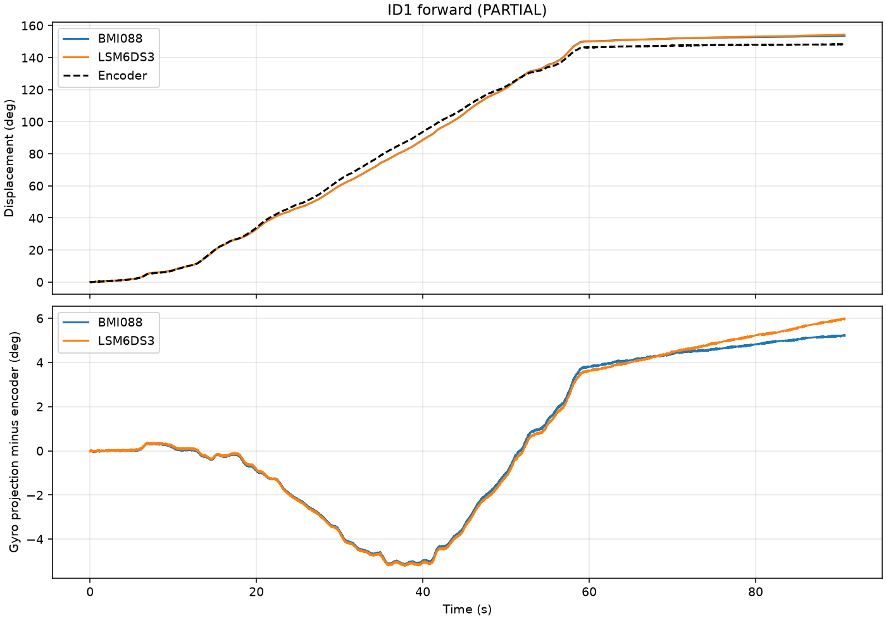

# 验证记录

本文保存对应归档的原始报告。日期、版本、通过范围和结束状态仅对当时现场有效，不表示当前板上状态。当前阅读方法见本目录说明文件。

---

<!-- 原报告：README.md；原文 SHA256：d79fbfed19563fc611af5c2bac2350e2e9644f3582a0573681113e131ae71277 -->

# 转台三轴完整扫转尝试 — 2026-10-09

## 当前结论

已实现并烧录：三轴目标 3°/s、加速度 3°/s²；ID1/2 各 +361° 后回原始展开角度；ID3 按 5140→4264→跨零→2096→5140，逐轴运动，其余轴保持。用户选定两端各内缩 64 raw。首次恢复豁免保持到 ID3 默认位到位，之后严格执行跨零软限位。

**实机未完成完整行程。** 两轮均完成三轴回位，ID1 正转约 148～150° 后不再前进。第二轮用户要求增大力矩，ID1 电压上限从 8000 提高至 10000（速度不变，ID2/3 仍8000），仍不能越过相近位置。原因未确认，不能判定仅为电机力矩不足，也不能排除机械/线束阻力。没有继续提高输出或自动重试。ID2 整圈及 ID3 两端往返尚未执行。

板端最终保留 run2 固件，故障7 / 轴1 / 净位移0.17578125°；三轴持续发零，ID3因重力回到约4045。GDB读取故障和三个命令0后 detach；CDC1复核仍锁存、全零。GDB/J-Link/CDC1均已释放。**当前锁存只在RAM，复位或重新上电仍会自动尝试运动。**

## 代码与保护

只改示例应用、测试、采集/分析及文档，没有修改SDK公共API、CAN驱动、CubeMX生成内容、线程调度或内存分区。仍为1ms托管任务，32个只读源（新增sequence_revision=2），双IMU各1kHz。输出超速附加阻尼；8°/s估计速度、5rpm原始速度、温度、反馈时效、限位等硬保护保持。

run1暴露原堵转判据的问题：编码器小幅抖动让“瞬时估计速度<0.2°/s连续3秒”的计时反复重置；ID1长期到8000仍未自动保护，主机发送STOP结束。已改为连续高于本轴输出上限95%、目标误差>1°时，3秒实际净位移<0.6°就锁存Fault7并全轴归零。新增±1raw抖动回归。run2实机观察到该保护触发，末3秒仅移动4raw。

GM6020输出是协议电压raw，反馈电流也仅记录raw；没有将10000换算成安培或声称力矩增加25%。

## 实机结果

| 项目 | run1（8000） | run2（ID1 10000） |
|---|---:|---:|
| ID3开始恢复到进入ID1回位 | 45.106 s | 41.725 s |
| 相对上版run15的94.165s | 2.09倍 | 2.26倍 |
| ID1正转编码器位移，未完成 | 149.985° | 148.359° |
| 结束原因 | 主机STOP，fault9 | 新堵转保护，fault7/轴1 |
| BMI088样本 | 203045 | 179636 |
| LSM6DS3样本 | 203044 | 179635 |
| 两流序号不连续 / 解码错误 | 0 / 0 | 0 / 0 |

run1原始采集因KeyboardInterrupt发STOP后退出，原脚本未写summary；保留完整rx.bin、分析、stdout及停止后复核。脚本已修正，中断会保存interrupted摘要。run2正常按故障结束并写摘要。run1参考旧启动raw约4044，run2约4046，比较不是严格相同负载试验。

## IMU与电机对比

分析用静止段扣陀螺偏置；ID3抬升取三轴积分向量模，ID1按本段积分方向估计旋转轴并投影。轴方向由同一段数据估计，因此这是相对一致性观测，不是独立标定或精度认证。ID1部分段包含末尾停滞时间，偏置漂移会累积；不包含故障后ID3回落。

| 运动段 | 编码器 | BMI088 | LSM6DS3 |
|---|---:|---:|---:|
| run1 ID3抬升 | 48.340° | 48.166° | 48.387° |
| run2 ID3抬升 | 48.076° | 47.830° | 47.158° |
| run1 ID1部分正转 | 149.985° | 158.272° | 157.929° |
| run2 ID1部分正转 | 148.359° | 153.596° | 154.344° |

ID1差值明显且随时间变化，不能据此宣称校准通过或直接估算单一比例系数。完整正反转、ID2、ID3扫转及闭环返回残差仍缺数据。

## 软件验证与证据

- 主机控制/绑定测试通过，含跨零限位、到默认位结束豁免、反馈/时序/速度/STOP、命令时效、抖动堵转及三轴完整轨迹模拟。模拟峰值3.24°/s，不代表实机性能。
- 合成数据验证361°正反、ID3允许弧、双IMU投影和闭环残差通过；长时分析用紧凑数组存储。
- Debug固件构建和十二目标父工程检查通过；D1 279712B，ITCM63104B。没有增加新的内存区域。
- J-Link10114514，STM32H723VG，SWD4MHz，3.30V；两次下载.text校验匹配。最终固件为build/IMUTurntableFullSweep/board/run2.elf。
- 本目录含分析JSON、部分运动图、两轮GDB/采集日志、测试日志、run2摘要和释放后复核。原始流/ELF及当前源码SHA256见manifest.json；大型原始文件保留在仓库build/IMUTurntableFullSweep/board/，未纳入源码。
