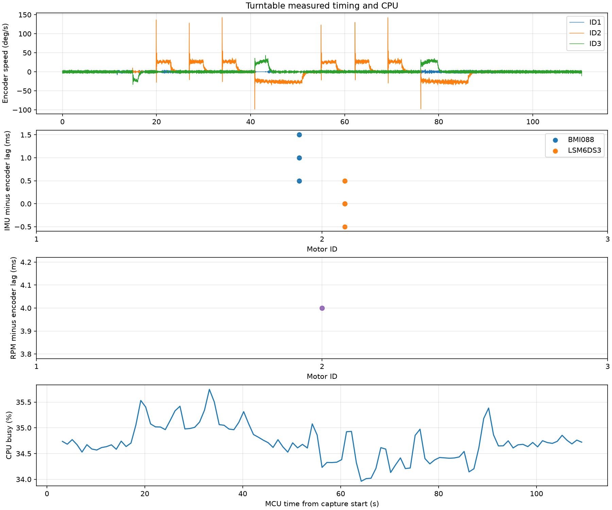

# 验证记录

本文保存对应归档的原始报告。日期、版本、通过范围和结束状态仅对当时现场有效，不表示当前板上状态。当前阅读方法见本目录说明文件。

---

<!-- 原报告：README.md；原文 SHA256：e318aa58e6629dcb5621f41acebaf7079a28ec229270664f9a98bd3ac3419f52 -->

# USART1 Panic 默认输出与转台时延/CPU 实测（2026-10-10～11）

SDK 默认 Panic 输出已改为 USART1 TX PB14、115200/8N1，并完成烧录、实际串口报告与软件复位验证。本次按用户要求只评价延迟和占用；桌面振动已知，不评价校准结果、不调整校准阈值或电机控制器。

## 固件与范围

- STM32H723VG，J-Link 10114514，SWD 4 MHz，3.30 V；CDC1 `/dev/cu.usbmodem355C343932333`，USART1 通过 J-Link OB VCOM `/dev/cu.usbmodem0000101145141` 接收。
- `build/IMUTurntableLatency/SirinEmbedOS.elf`，Debug、revision24；`.text` 与板上比较 matched。构建目录及原始二进制 SHA256 见 [清单](sha256.json)。FLASH 312224 B、D1 282912 B、D2 6848 B、D3 544 B、ITCM 63104 B；DTCM 128 KiB 为链接预留口径，不等于实时栈/堆占用。
- 本次变更只涉及 SDK Fault 紧急输出、新私有寄存器实现、示例开启现有 Low/4 KiB/1 Hz Monitor 与 revision、采集分析工具和文档；公共 API 签名、CubeMX 生成区、链接段、控制参数与运动限位不变。仓库已有其他未提交工作保持原状。
- 先在三轴零输出阶段烧录/故障注入，随后退出调试器与 GDB Server，再启动已授权转台动作。运动后一直保持通电承重，没有再次暂停、复位或刷写。

## USART1 验证

默认 sink 仅不可恢复 Fault 阶段启用 HSI，按当前 HSI 分频计算波特率，复位 USART1 并将 PB14 配置 AF4 TX。USART1/6、UART9/10 共享内核 mux 在此阶段切换到 HSI；随后 reset/halt，不恢复任务。时钟、TEACK、TXE、TC 均有界轮询并锁存失败，不依赖 HAL tick、RTOS、DMA 或堆。正常启动无端口预留；现有启动期自定义 Emergency writer 覆盖默认。

[物理串口记录](explicit-panic-usart1.txt) 包含 `Reason=0x00000002(ExplicitPanic)` 到 `Resetting after fault hook...`。注入从 ApplicationMain 安全栈处转入真实 `SRNOS_Fault_PanicContext`，参数是只设 reason 的合成 context，因此报告 PC/堆栈零值是注入方式所致，不能据此评价自然异常上下文解码。复位后 active=0、last reason=2，见 [GDB记录](explicit-panic-gdb.log)。未故意在承重阶段触发 Panic。

首次注入错误地引用被链接回收的 `SRNOS_Fault_TriggerPanic`，GDB 将其解析为地址0，造成 UsageFault/UNALIGNED；串口同样输出，但这次不是成功的显式 Panic 注入。保留 [完整记录](flash-and-first-injection.log) 和 [串口文本](first-injection-usart1.txt)，不把该合成故障的异常栈值当生产故障证据。后续已纠正入口并完成上面的独立验证。

## 采集方法

`Examples/IMUTurntableBringUp/measure_latency.py --motion` 启动已有任务配方，不写 EEPROM；15 个电机标量各500 Hz（编码器、展开角度、电压指令、RPM、电流反馈），双原始 IMU 与 INS 各1 kHz，系统统计1 Hz。电机值使用应用发布时刻，IMU 使用采集完成时刻，均为 MCU 时基；不使用 USB 包到达电脑的时间估计传感器时延。

完整有效记录 `build/IMUTurntableLatency/live2` 为约110.6秒，BMI/LSM各110601条、INS110600条；协议解码错误0、双IMU序列缺口0。任务57092119在80.325秒/step8进入中止保持，记录继续约20秒。依照用户要求不排查该静态校准错误6，也未保存 EEPROM。前一份 `live` 因状态查询暂态 BUSY 中止；随后只为幂等状态查询增加有界重试，未自动重发运动命令，第一份不纳入主要时延统计。

分析用1 ms共同网格、对称 Savitzky–Golay 31 ms窗口求编码器角速度/平滑陀螺；先选单轴速度>5°/s、其他轴<2°/s、位移>15°的独立段，再在±80 ms范围做陀螺三维向量与编码器速度的线性拟合。正值表示第二信号较晚。得到6段独立 ID2 约90°运动，ID1/ID3无满足该独立筛选条件的样本；不能外推为三轴分别测量完成。

## 时延结果

| 相对关系 | 六段结果（默认窗口） | 解释 |
|---|---|---|
| BMI088 陀螺相对编码器速度 | 中位1.0 ms，范围0.5～1.5 ms | 21/51 ms分析窗口中位1.5 ms，因此报告约1～2 ms |
| LSM6DS3 陀螺相对编码器速度 | 中位0 ms，范围−0.5～0.5 ms | 不同分析窗口中位0～0.5 ms，可视为当前分辨率内基本同步 |
| 电机 RPM 相对编码器速度 | 六段均约4 ms | 21/31/51 ms分析设置均为4 ms；是内部速度反馈的表观滞后 |
| 电压指令→电流反馈 | 不足以可靠定量 | 六段只有1段相关拟合 R²>0.5，闭环和反电势/负载共同影响，不发布因果延迟 |

双IMU拟合 R²约0.987～0.991。500 Hz标量实际时间间隔中位约2.00 ms，P10/P90约1.07/2.92 ms；0.5 ms搜索步长不是0.5 ms测量精度。编码器量化、桌面振动、滤波形状、应用发布时间和IMU内部滤波都进入此结果。它不是纯 CAN 线延迟、HostLink往返延迟或从控制指令到机械运动的总延迟；没有 CAN TX完成/反馈帧硬件时间戳，不能把“约1 ms相对同步”当成“整个闭环1 ms”。

源码另有明确控制滤波：ID1/ID3速度环输入时间常数20 ms，ID2为100 ms，`alpha=dt/(tau+dt)`；这不是固定延迟，但会明显影响响应。IMU用于观测/调平/校准，当前高速速度PI由编码器估计速度驱动，不是串行等待双IMU再发每一条CAN命令。本次没有改这些滤波或恢复虚拟轨迹。

## CPU 与任务时序

| 配置 | CPU中位 | 范围/说明 |
|---|---|---|
| 高频电机+双IMU+INS记录 | 34.6873% | 排除开头3秒，107个1 Hz窗口；P10/P90 34.2919/35.1245%，最大35.7467% |
| 高频记录中的运动片段 | 34.6362% | 标签按统计时刻速度判断，边界窗口可能混合状态 |
| 高频记录中的静止承重 | 34.7086% | 同上 |
| 只订阅1 Hz系统统计，原姿态承重 | 23.9405% | 25秒复测，去前3条后23个报告，23.5090～24.2507% |

两种观测配置中位相差约10.75个百分点。低流量是保持阶段对照，不能精确分解运动、采集和编码各自成本，也不等同于 Studio 特定界面实际订阅负载。CPU采用 FreeRTOS runtime 的1−Idle口径，ISR时间归入被中断任务，不是纯任务指令计数。

高频采集时主要任务中位占用：

| 任务 | CPU |
|---|---|
| SRNOS_HostComm | 9.565% |
| SRNOS_SPI4 | 7.901% |
| SRNOS_CAN3_TX | 5.090% |
| TurntableView | 3.486% |
| SRNOS_INS | 2.760% |
| SRNOS_CAN3_RX | 1.666% |
| SRNOS_BMI | 1.317% |
| SRNOS_LSM | 1.107% |
| SRNOS_Monitor | 0.056% |

TurntableView周期1 ms；收到21个不重复循环统计窗口，累计覆盖21.016秒/21016次循环。窗口内平均执行耗时的中位37 µs、最长189 µs（包括被抢占/ISR时间），最迟启动246 µs，周期偏差范围−183～190 µs，deadline_misses=0、skipped=0。循环流按任务轮转，只能确认这些收到的窗口，不宣称110秒每次循环全覆盖。当前记录未显示 CPU 饱和或持续调度迟滞。

机器可读结果见 [分析](latency-analysis.json)、[21 ms敏感性](sensitivity21.json)、[51 ms敏感性](sensitivity51.json)、[低流量CPU](monitor-only-summary.json)。原始大体积帧留在构建目录，报告保存其哈希。

## 验证与结束状态

- Core原有主机测试以及USART1正常、HSI分频、时钟超时、发送超时、Flush超时五种场景通过，见 [Core日志](core-tests.log)。固件构建链接通过，供应商头现有 optimize attribute warning 保留。
- 转台 `test_observation`（含revision24、Monitor启用与默认电机旁路）通过。随后旧 `test_control` 在第25行失败：夹具仍以早期raw5140判定回默认结束，而当前默认种子已是raw5070；本次未改控制器，也未为此展开旧运动模型测试重构。不能宣称完整转台主机套件通过，见 [日志](turntable-tests.log)。
- 最终只读查询：job57092119，phase10/中止保持，p1=15.3809°、p2=209.0918°、p3=188.3936°（ID3相对软件弧起点），目标p3=188.3057°；saved=0，见 [状态](final-status.json)。采集末motor fault=0，三轴保持通电，**不是零输出或允许断电状态**。
- CDC1订阅已关闭、串口释放，GDB/J-Link Server已结束，MCU继续运行。没有提交、推送或重新写入校准 EEPROM。
