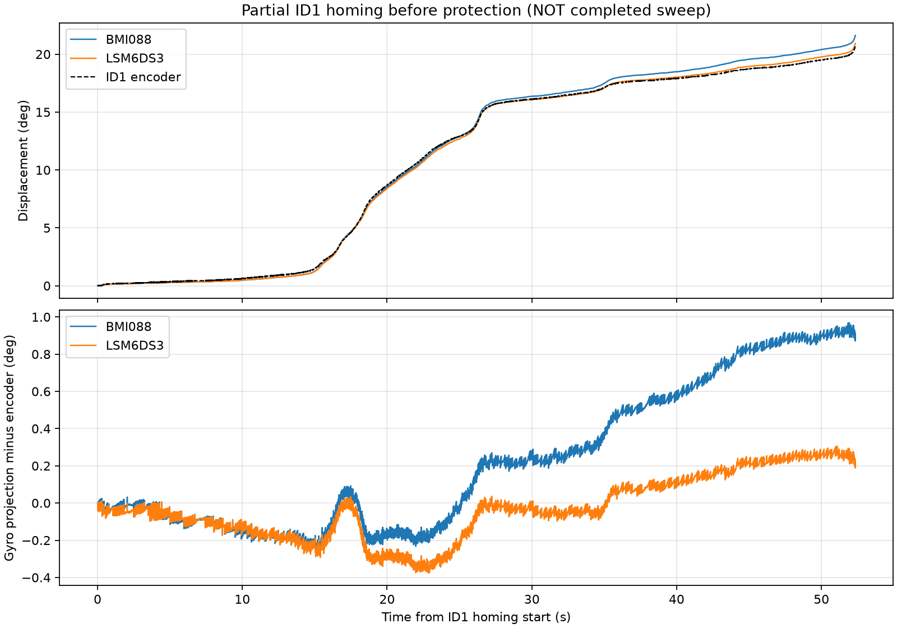

# IMU 转台低速控制验证（2026-10-09）

本记录是自动运动版本，历史 [只接收验证](../IMUTurntable-20261009/README.md) 不证明本控制器可用。用户授权上电回默认、低速 ID1 转动与双 IMU 比较，并确认 ID3 最大重力负载、掉电落在约 4044 raw 机械限位；首次允许从软限位外恢复，后续越界必须锁存三轴零指令。run12 后用户明确首次豁免持续至 ID3 到达默认 5140；此前以首次跨过 4200 为结束时刻的实现已修正。

应用源码在 `Examples/IMUTurntableBringUp`。ID3 允许弧 4200→8191→0→2160、默认 5140；ID1/2 默认 350/4850。当前首次恢复为 2°/s，正常回位/扫转 1°/s（run1–run9 恢复目标曾为 1°/s，run1–run10 正常目标曾为 2°/s），加速度 2°/s²，电压上限 8000 raw。低速控制依赖编码器差分，保留估计速度 8°/s 与原始 5 rpm 保护。电压 raw 不是扭矩或安培。三轴按 ID3、ID1、ID2 顺序回位，未回位轴先保持初始位置。保护不能阻止失去输出后的重力回落。

## 已完成的软件检查

- 应用主机回归：跨零软限位、仅首次恢复、到默认位结束豁免后再出界、故障锁存、故障轴/触发值、反馈超时、温度、速度、控制时效和 STOP；含重力的完整模拟回位、+30°、返回保持通过。
- Debug 构建和十二目标父工程检查通过；模拟不证明真实机构稳定性。
- 当前 31 项只读 SOURCE V2（run6–run12 为 25 项，run13 新增电流 raw 与温度） 与双 IMU 原始流；本地独占 CDC1。上位机不写参数或 EEPROM。

## 板端诊断过程

| 运行 | 结果与限制 |
|---|---|
| run1–run4 | 最初 2 rpm 门槛在静止 ID1 编码器只抖 1 raw 时也反复拦截。诊断记录有 -2 rpm 的离散反馈，改用编码器连续静止判定，并保留 5 rpm 辅助保护。 |
| run5 | ID3 成功越过 4200，升到约 4445 raw；双 IMU 记录约 120°/s 瞬态，保护锁存后输出零，ID3 因重力回落。用户确认当时手动碰动转台。未到默认位。 |
| run6 | 增加 ID1/2 初始位置保持和故障轴/触发值。ID1 收到负电压后编码器持续增加，估计 8.0987°/s 触发故障 4，轴 1，全部归零。用户确认无人碰动、桌面可能小幅振动；未将电机位移归因于桌面。 |
| run15 | 三轴 PI 200/100，ID1/2 双向电压斜率40000；ID3到5140并持续保持，ID1跨零回位到约122后，估计8.070°/s触发保护。终止继续实机调参，全轴零指令；未完成ID1默认位及往返。 |
| run14 | ID3 Kp提高至200，降低电压的斜率增至40000 raw/s；成功到默认位附近5142并保持，启动豁免结束，随后进入ID1回位。ID1在约7974后加速至8.108°/s触发保护，全轴零；尚未完成ID1回位。 |
| run13 | 首次豁免延续至5140到位，加入电流/温度；正常跨过4200，ID3在约5038附近缓慢移动后加速，估计8.122°/s触发保护。当时约32°C，电流约5900 raw；未完成回位。 |
| run12 | 用户要求保持同参数再次触发并现场观察；约 31 秒在首次 4200 后读到 4199，严格限位锁存三轴零输出。用户确认平稳抬升、停止输出后才回落；这次未重现约 4800 附近的异常。 |
| run11 | ID3 PI 改为 80/100，正常速度降至 1°/s；抬升约 77 秒后，在精细遥测约 4831 raw 处出现反向瞬态，原始 -5 rpm 触发故障 11 / 轴 3，零输出后重力回落。其他两轴在此前保持稳定。 |
| run10 | 恢复目标改为 2°/s，ID3 越过边界并升至约 4900 raw；随后在约 4941 raw，估计速度 8.0557°/s 触发轴 3 超速，全部归零。未到默认位置，未执行 ID1 扫转。 |
| run9 | 修正 ID1 输出方向后保持稳定；ID3 首次进入 4200 后反馈回到 4199，触发故障 3 / 轴 3 / 值 4199，三轴零输出。实板验证了“一次进入后再越界锁存”，没有增加限位容差。 |
| run7 | 独立诊断镜像，仅 ID1 正电压渐增至 600 raw，编码器约 7860→7849，归零后回弹。无超速；定时 STOP。 |
| run8 | ID2 +600 raw 仅约 1 raw 位移；ID1 -600 raw 从约 7857→7867，归零后回弹；定时 STOP。ID1 正反核验支持将应用输出方向设为 -1。ID2 位移太小，尚不足以全面确认其方向。 |

run7/run8 诊断源码只保存在 `build/IMUTurntableMotion/probe-source`（后者覆盖前者），相应 ELF 使用独立 run7-probe/run8-probe 快照，不属于默认应用。每次烧录后核对 `.text` 与目标一致。原始流、不可变 ELF、GDB 和 J-Link 日志在 `build/IMUTurntableMotion/board`；此处保留摘要与 SHA256，原始流未加入源码。

run11 保护前抬升段：编码器 34.497°，去启动静止偏置后的 BMI088 陀螺积分模长 34.848°、LSM6DS3 32.345°。这里只比较 ID3 单向抬升，存在积分漂移与轴耦合，不代表校准精度；ID1 往返仍未执行。

run14 已完成 ID3 回默认并保持、进入 ID1 回位。仍不能从这些尝试宣称三轴回位、ID1 完整往返或电机/双 IMU 一致性已通过。后续运行结果继续记录于此。

## 最终状态与可复现分析

最终板上为 `run15.elf`，源码与 ELF 哈希见 manifest。主机测试、固件构建、完整十二目标父工程检查通过。GDB 最后读取三颗电机实际命令原子均为 0、控制状态 Fault/Overspeed，然后 detach 并退出 J-Link；独占 CDC1 再次采集确认 fault=4、全轴输出=0，串口随后释放。固件仍运行且保护锁存；复位/重新上电会重新尝试自动运动，当前保护不持久化。

ID3 在 run14/run15 实际到默认位置并保持，最大重力负载所需电流明显高于另外两轴。ID1 的慢行后突然加速仍未解决，最后超速保护导致三轴零输出、ID3回落到机械限位。不能据此宣称全部回默认、完整+30°/返回、长期稳定性或校准成功。

run15 持续约149.81秒，BMI088为149803样本、LSM6DS3为149802样本，无IMU序号缺口/重复或解码错误。初始等待及故障后展开角度/估计速度的无效位是预期行为，编码器原始值仍持续有效更新。

| 有效运动片段 | 编码器位移 | BMI088 陀螺积分 | LSM6DS3 陀螺积分 |
|---|---:|---:|---:|
| ID3抬升到默认位（约94秒） | 48.208° | 48.928° | 47.616° |
| ID1未完成的回位段（约52.35秒） | 20.742° | 21.614° | 20.931° |

ID1分析剔除故障前最后300ms及后续回落，使用回位前0.85秒静止段去陀螺偏置；该段各轴编码器变化不超过1 raw。每颗IMU该段52345样本，最大采样间隔分别约1.069/1.109ms。投影轴由同段积分估计，偏置和轴向并非独立标定，所以差值仅作相对一致性观测；不能把它当成标定误差或证明编码器是外部角度真值。完整往返分析分支仍待取得完整实测数据。

复现命令：在安装NumPy、Matplotlib的Python环境运行 `Examples/IMUTurntableBringUp/analyze.py build/IMUTurntableMotion/board/run15`。生成 analysis.json 和 partial-homing-comparison.png；完整扫转成功才生成 comparison.png。
