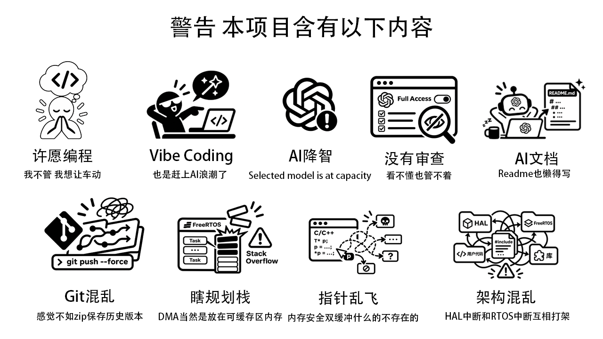

# SirinEmbedOS


本项目由Sirin (misaka@sirin.moe | m@sirin.moe) 和成吨的AI Agent token完成与维护，西浦OmniX机器人竞赛队的其他成员也参与了开发和测试。

[](https://git.omni-x.net/software/sirinembedos/sirinembedos/-/pipelines?ref=main)

## 简介
SirinEmbedOS是一个基于OmniCtrl系列机器人主控板（开源地址：[RMBBS](https://bbs.robomaster.com/article/1914397)）的开发SDK，提供了对FreeRTOS、总线、设备驱动和系统服务的管理。它支持四路CAN通信、串口通信、遥控、裁判系统、RS485通信以及通用输入快照和业务消息处理。SDK还提供了RM图传遥控器、WFLY W.BUS原始接收、LAN8720以太网通信、NOR黑匣子异步读回、传感器姿态与温控、日志记录和USB CDC通信等功能。

其原生平台为STM32H723VGH6，使用ST ARM Clang进行编译，目前也在进行对N32系列、GD32系列、STM32MP257的M33核的适配工作。目前，项目基于FreeRTOS、 ST HAL库、FATFS和LwIP，并使用CMake进行构建。推荐使用CLion作为IDE，不过任何支持CMake的IDE都可以使用。

项目初始代码由STM32CubeMX生成，但SirinEmbedOS已经接管了绝大多数的HAL和CMSIS代码，CubeMX仅用于生成硬件配置和部分初始化代码。绝大多数情况下，本项目对于MX的regenerate是安全的，不过并不推荐直接修改MX的ioc文件，一些功能可能已经在SDK中实现过。

需要注意的是， SirinEmbedOS 并不是一个追求极致通用和高度抽象的系统，它单纯是作者为了验证设计的主控板是否能够正确初始化硬件并启动的产物，只是在开发过程中“顺手”完成了一些内容。然后逐渐变成了队内通用的开发SDK，最后也成功配合OmniCtrl系列主控板参与RoboMaster2026赛季，取得好成绩。因此SirinEmbedOS并不会针对通用的硬件平台适配，仅仅进行对OmniCtrl系列的支持，当然，作者欢迎其他开发者在此基础上进行移植和适配。

**作者的主业是硬件系统设计，因此本SDK大多数代码都由AI完成，作者无法提供完整的细节说明和代码审计。目前只能确定的是，本SDK在目前的使用情况下没有出现太多问题，所以不排除在什么奇怪的地方藏着AI的一坨的情况发生。欢迎找作者探讨OmniCtrl系列的PCB设计细节和心得（开源地址：[RMBBS](https://bbs.robomaster.com/article/1914397) ）但本SDK建议作为PCB开发和行为参考即可。**



本项目托管于OmniX GitLab，启用了GitLab CI/CD，所有提交都会触发自动编译，可以在Git页面上方查看状态。GitHub作为项目镜像。

### 目前本项目仅兼容OmniCtrl 2 Pro Rev.C (型号2613到2616) Designed by Sirin，其他版本或硬件平台需要额外适配

## CONCEPT

本项目是一个开发SDK，其适合作为Git Submodule接入父项目，父项目可以是机器人控制算法、设备组合和业务任务。SDK提供了对FreeRTOS、总线、设备驱动和系统服务的管理，父项目可以专注于业务逻辑的实现。

在本项目中，父项目不直接触碰硬件和总线，也不应直接调用FreeRTOS的API，SirinEmbedOS依然基于FreeRTOS进行调度，但父项目创建Task应使用SirinEmbedOS提供的接口，SirinEmbedOS会在Task创建前后插入探针方便统计Task占用率和CPU使用率，并避免父项目Task优先级过高影响系统服务。

在本项目中，任何总线和可复用的硬件外设都应该使用SirinEmbedOS提供的接口，每个总线都有一个专门的Router Task（如CAN/SPI/I2C等）对其进行管理，避免父项目直接操作总线导致的冲突和不可预期的行为。父项目可以通过SirinEmbedOS提供的接口注册自己的业务回调，SirinEmbedOS会在总线接收到数据时调用这些回调。

本项目默认对外暴露两个USB Device设备，其中一个是CDC虚拟串口，可以使用SDK提供的接口进行日志输出和调试，另一个是SirinLink协议设备，可以使用SDK提供的接口进行业务数据传输。父项目可以通过SirinEmbedOS提供的接口注册自己的业务回调，SirinEmbedOS会在接收到SirinLink协议数据时调用这些回调。

本项目自带一些协议的解析和封装，如VT02 VT03 WFLY等，CAN总线自带DJI RM系列电机、达妙系列电机等，可进行扩展。同时还自定义了一些协议，如SirinLink是基于COBS分帧进行的Raw传输协议、SirinRMT是遥控数据协议（可能在后续更新协议规定，不保证向下兼容，也可以由父项目自定义）。注意协议间层级不一样，如SirinLink可以跑在UART上，然后实现SirinRMT over SirinLink等。

项目在初始化时可以使用类似设备树的方式进行配置，来适应不同的外设需求组合，如在CANx上注册一个CANID为y的z品牌电机，或者在UARTx上注册一个SirinLink协议的设备。父项目可以通过SirinEmbedOS提供的接口注册自己的业务回调，SirinEmbedOS会在接收到数据时调用这些回调。

***--接下来的内容就是Agent写的了--***

## 开始使用

本仓库提供 OmniCtrl 2 Pro Rev.C 的 STM32H723VGH6 固件目标。用 ST Arm Clang / Picolibc、CMake 和 Ninja 构建；CLion 打开 SDK 或父项目的根目录。当前板级接线、CubeMX 生成边界及固件链接布局见 [Board](Board/README.md)。

从 SDK 根目录构建 Minimal：

```sh
cmake --preset Debug -DSIRINEMBEDOS_EXAMPLE=Minimal
cmake --build --preset Debug
```

产物为 `build/Debug/SirinEmbedOS.elf` 和同目录的 `.map`。接入父项目时可按下面的顺序阅读：

1. [QuickStart](QuickStart.md) — 配置工具链、创建父工程并运行一个周期任务。
2. [初始化配置指南](Docs/Config.md) — 在启动回调中给 CAN 通道注册电机、声明 UART 并绑定协议。
3. [独立 C 文件注册 Task](Examples/StartupTask/README.md) — 将任务源文件加入固件，由父项目的配置入口注册。

## 能力与入口

| 想做什么 | 从哪里开始 |
|---|---|
| **接 VT03/VT13 图传遥控器** | 921600、8N1。只接收摇杆、档位、键鼠时开启 RX；需要双向自定义数据或自动回传遥测时，再开启 TX 和 VideoLink。[遥控接入](Source/Services/RemoteControl/README.md#vt03vt13-接入) · [双向图传](Source/Services/VideoLink/README.md) |
| 接 DR16、WFLY W.Bus 或 VT02/VT12 | DR16 提供摇杆和键鼠，W.Bus 提供原始通道与可选校准，VT02/VT12 支持键鼠及 A5 自定义数据。[DR16 与串口配置](Examples/PrototypeBindings/README.md) · [W.Bus](Source/Services/RemoteControl/WBus/README.md) · [VT02/VT12](Docs/VT02VT12.md) |
| 接 CAN 电机或使用原始 CAN FD | 四路 CAN 在启动时分别选择 Classic 或 FD。现有电机适配器使用 Classic 1 Mbit/s。[电机型号与示例](Source/Devices/Motors/README.md) · [CAN](Source/IO/CAN/README.md) · [FD 示例](Examples/CANFD/README.md) |
| 接串口协议、裁判系统或 RS485 设备 | 配置物理端口后为它指定一个所有者，应用和内置协议通过同一套通道接口收发。[Serial](Source/IO/Serial/README.md) · [裁判系统](Source/Services/Referee/README.md) · [RS485](Source/IO/RS485/README.md) |
| 读取输入、处理业务消息 | Input 提供各来源的一致快照和事件，Message 按 service/type 分发，SirinRMT 可携带通道、按键、相对增量或车体系平面速度。[Input](Source/Services/Input/README.md) · [Message](Source/Services/Message/README.md) · [组合示例](Examples/InputMessages/README.md) |
| 看日志、订阅遥测、调参并保存 | 一个 USB 复合设备提供两个 CDC 串口。CDC0 输出文本日志，CDC1 提供 SirinLink 命令、遥测和参数访问。可写业务参数支持显式保存到 EEPROM。[日志](Source/Services/Logging/README.md) · [参数与遥测示例](Examples/Parameters/README.md) · [主机 CLI](Tools/CmdLineTool/README.md) |
| 使用板载传感器与存储 | 读取 IMU、环境和姿态，查询温控状态；EEPROM 保存身份、校准和业务参数，NOR 提供黑匣子记录。当前构建提供这两类存储接口，未集成 FatFs。[Sensors](Docs/Sensors.md) · [INS](Docs/INS.md) · [EEPROM](Docs/Storage.md) · [黑匣子](Source/Services/Blackbox/README.md) |
| 使用以太网与系统诊断 | LAN8720、静态 IPv4、UDP/Ping 和 NTP，另有 ADC、CPU、任务运行和异常记录。[Network](Source/Services/Network/README.md) · [Clock](Source/Services/Clock/README.md) · [系统监测](Source/Services/SystemMonitor/README.md) · [Fault](Source/Core/README.md) |

## 托管任务与父项目内核接口

SDK 持有板级 `main()` 和调度器。父项目只需包含 `SirinEmbedOS/` 公共头，通过 `sirinos_add_firmware()` 或 `SirinEmbedOS::Platform` 链接。固定任务在 `SRNOS_ApplicationConfigure()` 填入启动列表；需要管理句柄的任务可在 `SRNOS_ApplicationMain()` 或已有任务中调用 `SRNOS_ThreadCreate()`。每次 `step` 完成一轮工作，等待和周期调度由 SDK 执行。[固定任务示例](Examples/StartupTask/README.md) · [运行期创建示例](Examples/Minimal/README.md)

应用任务名为 1～15 字节，保留 `SRNOS_` 前缀给系统使用；应用优先级为 1～39，栈按字节配置。动态创建成功后可通过 GetInfo 查询初始化结果。管理者负责 RequestStop、Join、Delete，Delete 成功后才回收任务参数。设备就绪、有效数据及资源余量分别读取相应状态。[Kernel](Source/Kernel/README.md) · [任务和内存](QuickStart.md#检查任务和内存)

## 开发与分发

SirinEmbedOS 自有代码采用 [Mozilla Public License 2.0](LICENSE)，允许商业使用。对外分发固件时，应告知接收者如何取得其中 MPL 文件对应版本的源码。第三方组件、生成模板及其派生文件的适用范围见[第三方许可说明](THIRD_PARTY_NOTICES.md)。

源码包含固定板配置、SDK 实现、应用示例及主机工具。CI 构建 Minimal 的 Debug/Release；测试套件、专用 BringUp 固件、现场日志与调试转储保留在分发范围之外。固件构建、CubeMX 生成和实板验证分别记录。[开发指南](Docs/Development.md) · [CI/CD](CICD/README.md) · [变更记录](CHANGELOG.md)

各模块的接口、示例和第三方来源见 [完整文档导航](Docs/README.md)。供应商许可随对应文件保留，包括 [第三方组件](ThirdParty/)、[板级 HAL/CMSIS](Board/Drivers/) 和 [MCP2518FD 驱动](Source/Devices/MCP2518FD/README.md)。
